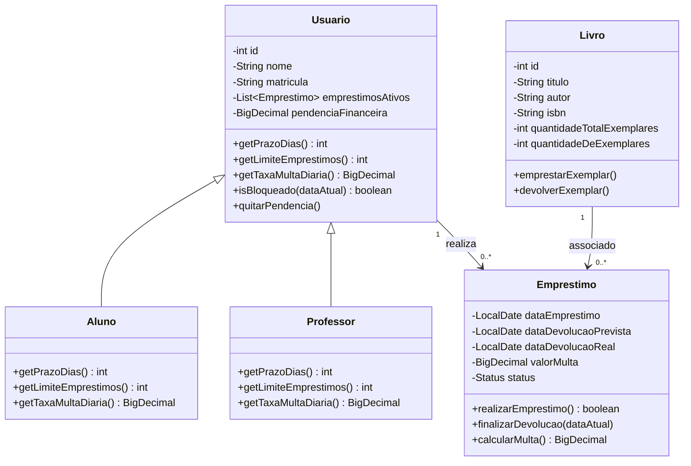

# Diagrama de Classes

# Regras de Negócio Implementadas

- Usuários têm identificador positivo, nome e matrícula obrigatórios. `Usuario` é concreto; seu comportamento padrão equivale ao perfil de aluno. `Aluno` e `Professor` especializam prazo, limite e taxa sem acrescentar atributos.
- Alunos podem manter até 3 empréstimos simultâneos, com prazo de 7 dias e multa de R$ 1,00 por dia de atraso. Professores podem manter até 5 empréstimos simultâneos, com prazo de 15 dias e multa de R$ 0,50 por dia.
- A data de devolução prevista deve corresponder ao prazo do perfil. O empréstimo é recusado se o usuário estiver bloqueado, atingir seu limite ou não houver exemplares disponíveis.
- Um livro vencido bloqueia novos empréstimos. Na devolução atrasada, a multa é calculada em centavos e registrada como pendência financeira; o usuário permanece bloqueado até quitar essa pendência. A quitação parcial é aceita, mas o bloqueio continua enquanto houver saldo.
- A devolução restaura o estoque, mas nunca permite que exemplares disponíveis excedam a quantidade total cadastrada. Empréstimos e devoluções inválidos lançam exceções com mensagens explicativas.
- Livros exigem identificador positivo, ISBN, título e autor não vazios e quantidade não negativa. Campos ausentes ou inválidos são rejeitados com `IllegalArgumentException`.
